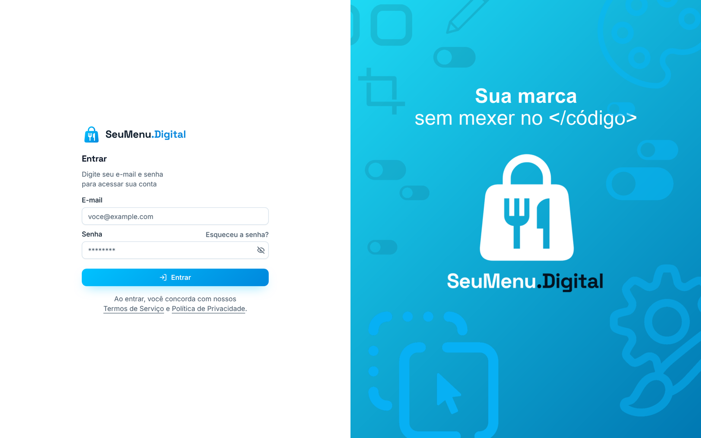
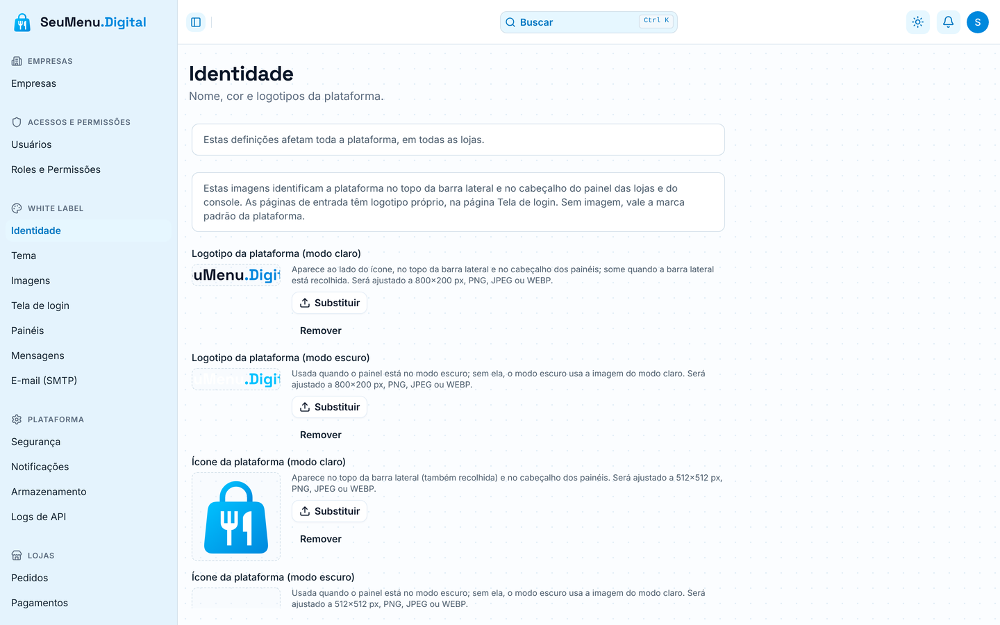
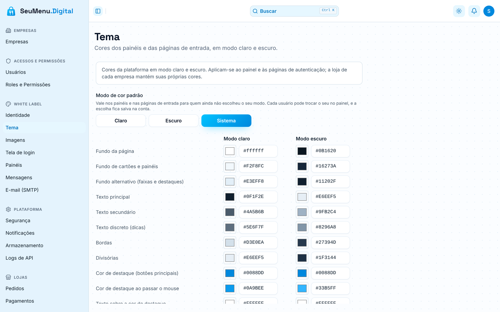
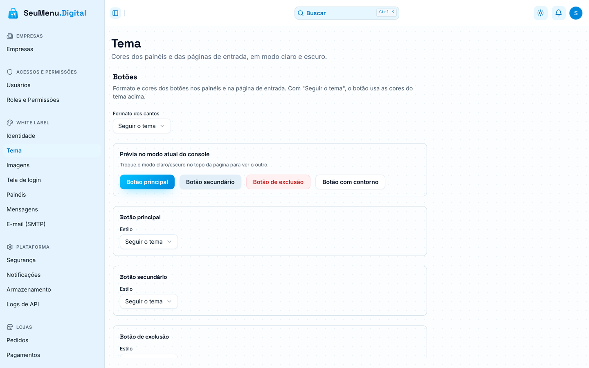
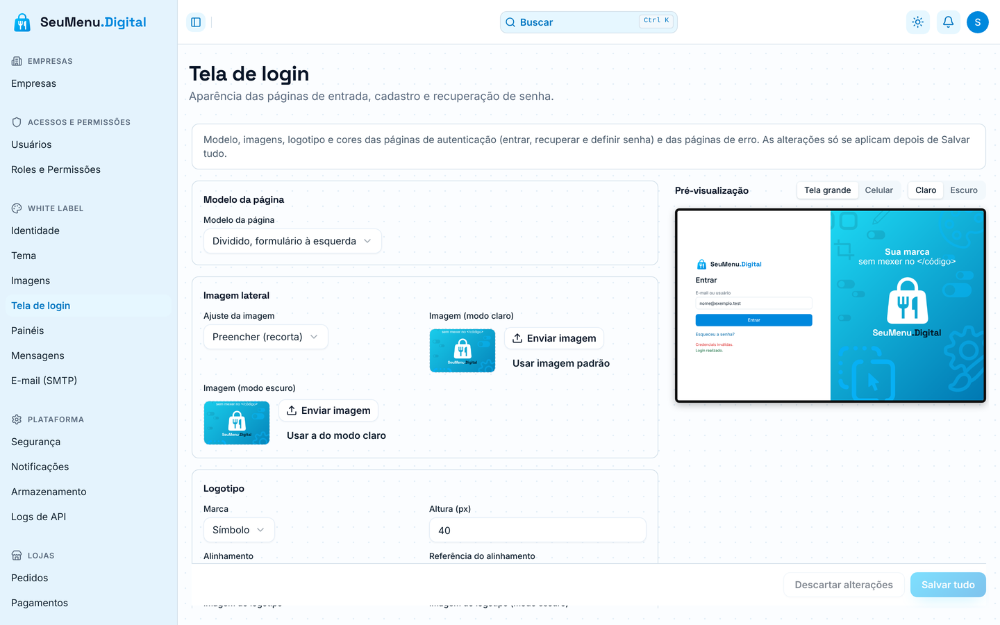
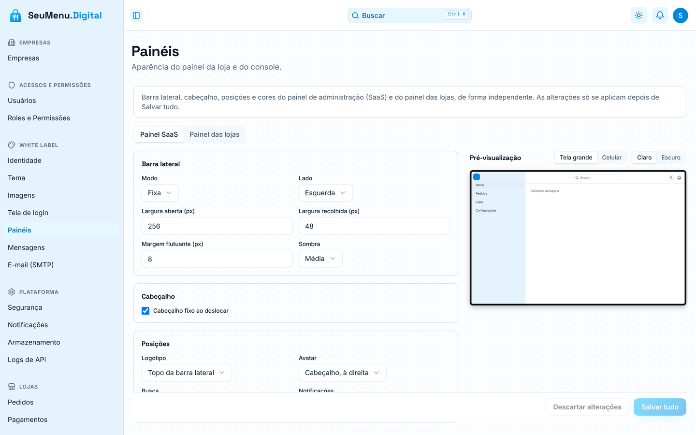
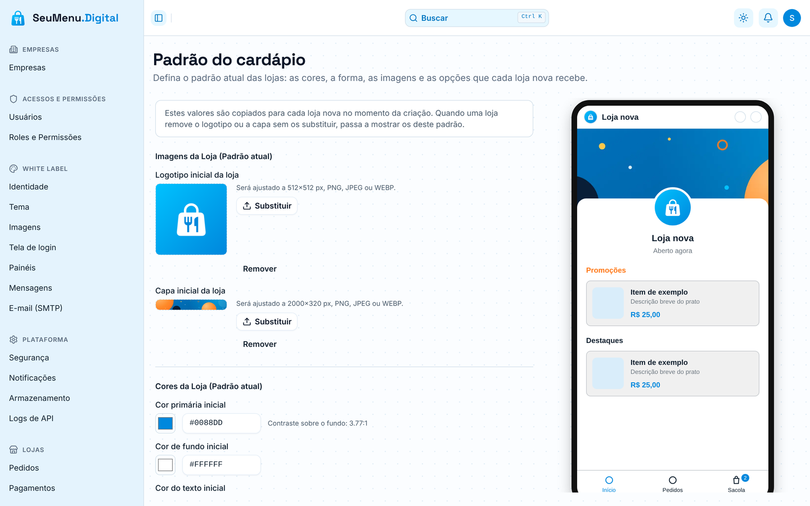
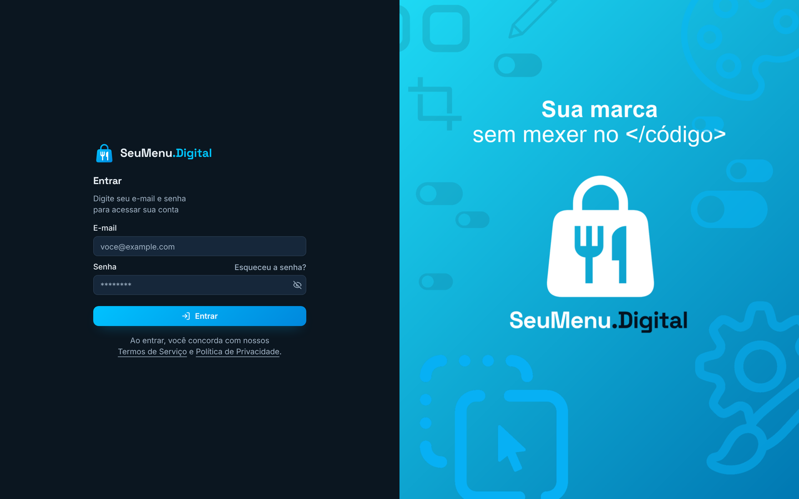

# SeuMenu.Digital

**Cardápio digital multiloja com a sua marca: pedidos em tempo real, entrega por região e PIX e cartão direto na conta de cada loja.**

[Site](https://seumenu.digital) ·
[Demo do cardápio](https://v1demo-cardapio.seumenu.digital/demo-oba-pizza) ·
[Demo do painel](https://v1demo-entrar.seumenu.digital) ·
[Descrição completa](https://seumenu.digital/compra-resumo/) ·
[Comprar o código-fonte](https://seumenu.digital/compra-resumo/#preco) ·
[Contato](https://seumenu.digital/contato/)

## Sobre

O SeuMenu.Digital é um sistema completo de cardápio digital para restaurantes, pizzarias, lanchonetes e outros negócios de comida. Você instala no seu servidor, coloca o seu nome, logotipo e cores, e oferece o serviço às lojas que atende.

Cada loja tem o seu painel, o seu cardápio público (`cardapio.seudominio.com.br/minha-loja`) e recebe os pagamentos online direto na própria conta do Mercado Pago. Sem comissão sobre pedidos.

Este repositório é a vitrine do produto. O código-fonte é vendido em [seumenu.digital](https://seumenu.digital/compra-resumo/) e entregue com documentação e guias de instalação.

## Demonstração

Experimente a loja de exemplo "Oba! Pizza", sem cadastro:

| O que | Link |
| --- | --- |
| Cardápio do cliente | [v1demo-cardapio.seumenu.digital/demo-oba-pizza](https://v1demo-cardapio.seumenu.digital/demo-oba-pizza) |
| Painel da loja | [v1demo-entrar.seumenu.digital](https://v1demo-entrar.seumenu.digital) (o login já vem preenchido) |

Na demonstração nada é enviado de verdade: o código de verificação e as mensagens do WhatsApp aparecem na própria tela, e os pagamentos usam o ambiente de teste do Mercado Pago.

## White label

O sistema é seu, com a sua marca. Tudo o que identifica a plataforma é configurado no console, sem mexer no código, e vale na hora para o painel das lojas, a página de entrada, o console e o cardápio.

- **Identidade**: nome da plataforma, logotipo e ícone (com versão para o modo escuro), endereço do site, título das páginas, contatos de suporte, razão social, CNPJ, termos de serviço e política de privacidade.
- **Tema**: todas as cores, no modo claro e no escuro, e o modo de cor padrão (claro, escuro ou do sistema).
- **Botões**: formato dos cantos e estilo de cada tipo de botão (principal, secundário, exclusão e contorno).
- **Tela de login**: modelo da página, imagem lateral, logotipo e cores das páginas de entrada, com prévia no computador e no celular.
- **Painéis**: barra lateral, cabeçalho e posição do logotipo, da busca, do avatar e das notificações, com prévia.
- **Mensagens**: posição, duração, cores e ícones dos avisos.
- **Padrão do cardápio**: logotipo, capa e cores que cada loja nova recebe.

A demonstração mostra o painel da loja e o cardápio; o console da plataforma não está aberto na demonstração. As telas abaixo são do console.

| | |
| --- | --- |
|  |  |
| **Identidade** | **Tema** |
|  |  |
| **Botões** | **Tela de login** |
|  |  |
| **Painéis** | **Padrão do cardápio** |
|  |  |
| **Entrada, modo claro** | **Entrada, modo escuro** |

## O que o sistema faz

**Console da plataforma (você)**
- cria e gerencia as lojas e libera, por loja, WhatsApp próprio, conectores de delivery e pagamentos online;
- white label sem código: nome, logotipos, cores, estilo dos botões, página de entrada, termos de serviço e política de privacidade;
- e-mail (SMTP), armazenamento de imagens (servidor ou S3), app Mercado Pago com participação opcional nas vendas, usuários, perfis e registros das integrações.

**Painel da loja (seus clientes)**
- dashboards, pedidos em tempo real em cartões, lista ou quadro, e caixa com abertura, lançamentos e fechamento;
- catálogo com itens, categorias, complementos e opções; cupons; clientes;
- horário de funcionamento, regiões e taxas de entrega no mapa, formas de pagamento e aparência do cardápio.

**Cardápio público (o cliente final)**
- destaques, categorias, busca, sacola e identificação por código de 6 dígitos (WhatsApp ou e-mail);
- endereço por CEP com pino no mapa e taxa calculada pela região;
- pagamento na entrega ou online por PIX e cartão, e acompanhamento do pedido em tempo real e pelo WhatsApp.

## Integrações

| Integração | Para que serve |
| --- | --- |
| Mercado Pago | PIX e cartão online, direto na conta de cada loja |
| WhatsApp (API oficial da Meta) | Código de verificação do cliente e avisos de status do pedido |
| Conectores de delivery | Pedidos do iFood, 99Food, Zé Delivery e outros no mesmo painel |
| E-mail (SMTP) | Avisos, recuperação de senha e código de verificação sem WhatsApp |
| Mapas e CEP | Busca por CEP, pino no mapa e regiões de entrega |

## Tecnologias

- **API**: NestJS 11, TypeScript, Prisma 6, PostgreSQL 16, Redis 7, Socket.IO.
- **Sites**: React 19, Vite, Tailwind CSS, TanStack Query, Leaflet, monorepo com npm workspaces e Turborepo.
- **Infraestrutura**: Docker Compose com HTTPS automático (Caddy).

Requisitos: um servidor Linux com 2 vCPU, 4 GB de RAM e Docker, e um domínio com 5 subdomínios. Inclui guias de instalação para Hostinger, DigitalOcean, Contabo, Locaweb, Railway, Render e qualquer VPS Linux. Hospedagem compartilhada (cPanel) não roda o sistema.

## Versões

| Versão | Data | Destaques | Status |
| --- | --- | --- | --- |
| 1.0.0 | 16/11/2026 | Primeira versão: console white label, painel da loja, cardápio público, Mercado Pago, WhatsApp, conectores de delivery e guias de instalação | Atual |

As correções de erros são gratuitas para quem comprou. As novas versões, com novos recursos, são pagas à parte, e quem comprou a v1 paga apenas o valor da atualização. Os avisos de correções e de novas versões são enviados por e-mail ao endereço informado na compra. Veja os detalhes em [seumenu.digital/compra-resumo](https://seumenu.digital/compra-resumo/).

## Comprar o código-fonte

| | |
| --- | --- |
| Produto | Código-fonte: o produto completo para instalar no seu servidor |
| Preço de lançamento | R$ 609,90 (por tempo limitado) |
| Preço normal | R$ 997,00 |
| Pagamento | Único, com lojas ilimitadas |

**[Ver a descrição completa e comprar](https://seumenu.digital/compra-resumo/)**

O código é entregue como está, sem suporte direto. Não inclui os recursos de IA, exclusivos das assinaturas. A revenda e a redistribuição do código não são permitidas.

Você pode modificar o código, mas responde sozinho pelas modificações que fizer. Se alterar, desativar ou remover as camadas e os recursos de segurança do sistema, as vulnerabilidades que resultarem disso e a sua exploração são de sua responsabilidade exclusiva. As novas versões e as correções são preparadas para o código original da versão comprada: conflitos ou falhas ao aplicá-las sobre um código modificado não são de nossa responsabilidade.

## Licença

Este repositório contém apenas a apresentação do produto. O código-fonte é distribuído sob licença comercial de uso: permitido em seus projetos e para atender seus clientes; revenda e redistribuição proibidas.

## Criado e mantido por

<table>
  <tr>
    <td>
      
    </td>
    <td>
      <strong>Nei Matos</strong> 
      Software Solutions Architect 
      <a href="https://github.com/neimatos">GitHub</a> · <a href="https://www.linkedin.com/in/neimatos/">LinkedIn</a>
    </td>
  </tr>
</table>

---

[seumenu.digital](https://seumenu.digital) · [LinkedIn](https://www.linkedin.com/company/seumenu-digital/) · [Aviso de privacidade](https://seumenu.digital/privacidade/)

